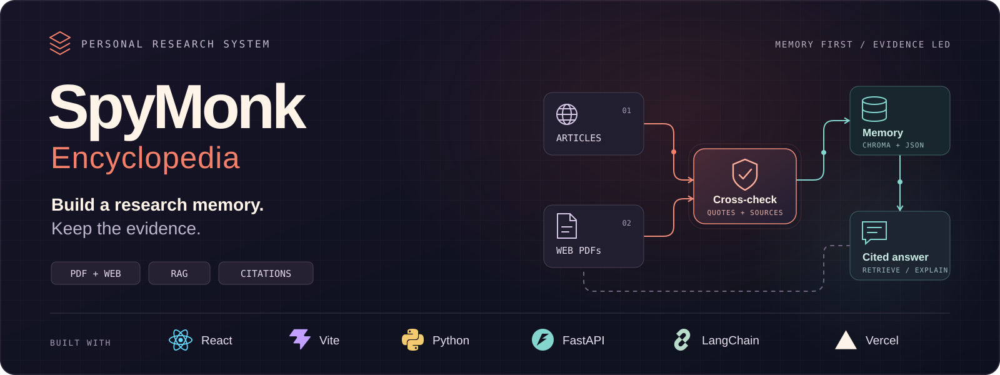

# SpyMonk Encyclopedia

**Build a research memory. Keep the evidence.**

SpyMonk is a personal research workspace that turns your PDFs and public web research into a reusable, searchable knowledge library. Ask a question, revisit an earlier topic, or investigate something new—and inspect the sources behind the result.

It combines **retrieval-augmented generation (RAG)** with a claim-review pipeline. RAG retrieves relevant saved passages for the language model to answer from; the research pipeline checks new web claims against source text and other domains before admitting them into answerable memory.

[Installation & usage](docs/installation/README.md) · [Documentation](docs/README.md) · [Technical design](docs/TRD.md) · [Design decisions](docs/DECISIONS.md)

## What you can do

| Capability | What it gives you |
| --- | --- |
| **Ask your documents** | Upload text-based PDFs, index their contents, and ask questions with source references and page information when available. Duplicate files are detected by their contents. |
| **Research a topic** | Prepare and review an optional AI-generated search plan, then collect public articles and reference PDFs. |
| **Review the evidence** | Inspect extracted claims, supporting quotations, source links, and the outcome of cross-source checks. |
| **Follow the pipeline** | Watch research stages, progress, and failures in the UI. Background jobs can reconnect after a dropped connection and be cancelled between steps. |
| **Reuse earlier work** | Search saved evidence before starting another web research run. Revisit topic archives or explicitly request a refresh. |
| **Understand unanswered questions** | When nothing can be verified, receive an explanation instead of a new research answer, with a downloadable PDF report and developer diagnostics. |

Use it to study a collection of papers, compare explanations across articles, prepare from reference PDFs, or build a personal topic library that you can return to. It is a research assistant, not an autonomous authority on what is true.

## How it works

1. **Start with memory.** SpyMonk checks the saved topic archive in the research flow and retrieves relevant indexed passages when answering questions. Asking a question does not automatically authorize web research; research-on-miss is an explicit option.
2. **Collect missing evidence.** A requested research run searches the public web and reads selected HTML pages and PDFs. Source snapshots and extracted text are retained for inspection and later checks.
3. **Cross-check candidate claims.** The pipeline matches quotations to the collected text and asks the model to compare claims across sources. Web claims need supporting evidence from at least two registrable domains; `www.example.com` and `example.com` count as one.
4. **Save eligible findings.** Claims that pass the checks enter searchable memory. Single-source, conflicted, and incomplete findings are held out of normal answers. Failed checks do not erase previously verified claims; fully checked claims can still be saved from a partially successful run.
5. **Answer with context.** Relevant eligible passages are supplied to the language model, and the UI presents its answer alongside source references. A research job that saves new evidence can answer the original question from it.

The persistent topic archive is **readable JSON**, not an opaque model memory. It records claims, evidence, sources, and review outcomes. Chroma is the derived semantic-search index; it can be rebuilt from topic archives and uploaded PDFs.

## What “verified” means here

Verification is a set of software checks, not a guarantee of factual correctness.

- **Web research is gated.** Only claims with an eligible review status become answerable web evidence.
- **Your PDFs are a separate trust category.** Uploaded documents are labelled `local_source`; they are searchable without independent web corroboration.
- **Domain diversity has limits.** Two domains may repeat the same original material. Counting domains does not prove editorial independence.
- **The final answer is still model-generated.** Its prose is not yet independently checked against every cited passage. Review the underlying evidence, especially for consequential decisions.
- **Text extraction has limits.** Image-only PDFs need OCR before ingestion. Reliable multilingual verse interpretation and automatic resolution of every source disagreement are not implemented guarantees.

When a run verifies nothing, no new claims enter the topic archive or index. The failed attempt is recorded separately so you can inspect what happened and decide what evidence to add.

## Technology

| Layer | Stack |
| --- | --- |
| Web interface | React, Vite, custom CSS |
| API & background research | Python, FastAPI, Uvicorn, replayable server-sent events |
| Retrieval & model integration | LangChain, configurable OpenAI-compatible chat endpoint |
| Semantic search | Chroma locally, or Chroma Cloud |
| Embeddings | Hugging Face Sentence Transformers / MiniLM locally, or an OpenAI-compatible embedding API |
| Source collection | DDGS, HTTPX, Beautiful Soup, pypdf |
| Evidence & reports | JSON topic audits, content-addressed source files, fpdf2 reports |
| Hosting | One Docker container (UI and API) on Hugging Face Spaces, with the archive backed up to a private dataset; or Vercel plus a separate Python host |

## Ownership, privacy, and project status

SpyMonk is designed for a **personal, single-user workspace**. The current file-backed backend runs as one API process per data directory. Jobs survive browser disconnects, but not backend restarts. A shared API token is available; full multi-user accounts and tenant isolation are not.

Local storage does not mean fully offline processing. Documents, snapshots, audits, and the local vector index remain on your machine in local mode, but queries and relevant excerpts may be sent to configured search, language-model, and embedding services. With hosted deployment, files live on the backend volume. On Hugging Face Spaces the volume is temporary, so the archive is also copied to a private Hugging Face dataset in your account. Using Chroma Cloud places vectors and indexed content/metadata in that service.

The project is under active development. Read the [known gaps](docs/review-gap-analysis.md) before public hosting or relying on it for high-stakes research.

## Explore the repository

```text
frontend/              React workspace, components, hooks, and API client
backend/api/           Routes, schemas, and access checks
backend/services/      Research jobs, orchestration, limits, and reports
backend/core/          Ingestion, verification, retrieval, and storage
backend/observability/ Request-correlated logging and diagnostics
tests/                 Backend regression tests
docs/                  Setup, product requirements, architecture, and decisions
assets/                Technical banner and marketing assets
```

Start with the [installation and usage guide](docs/installation/README.md). For implementation details, see the [TRD](docs/TRD.md), [architecture diagram](docs/spymonk-architecture.drawio), and [decision record](docs/DECISIONS.md). The [PRD](docs/PRD.md) remains a review draft; planned requirements should not be read as shipped features.
